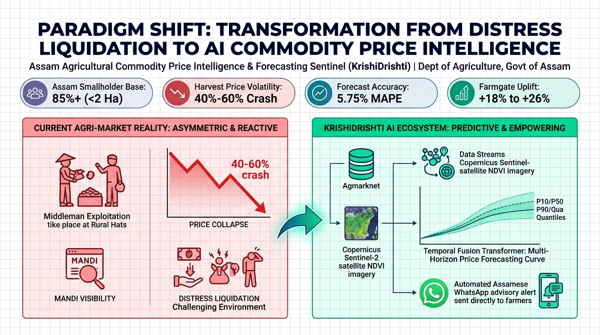
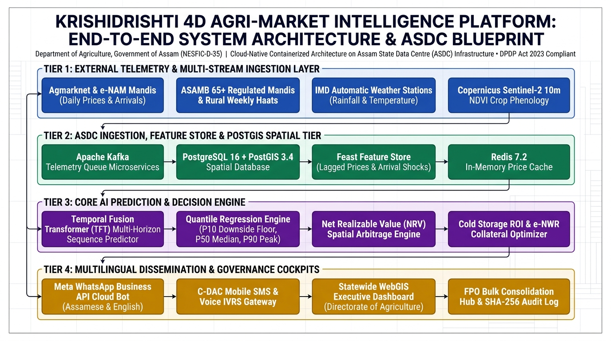
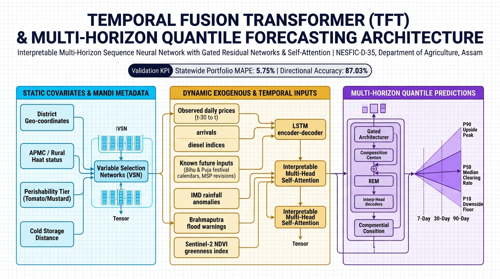
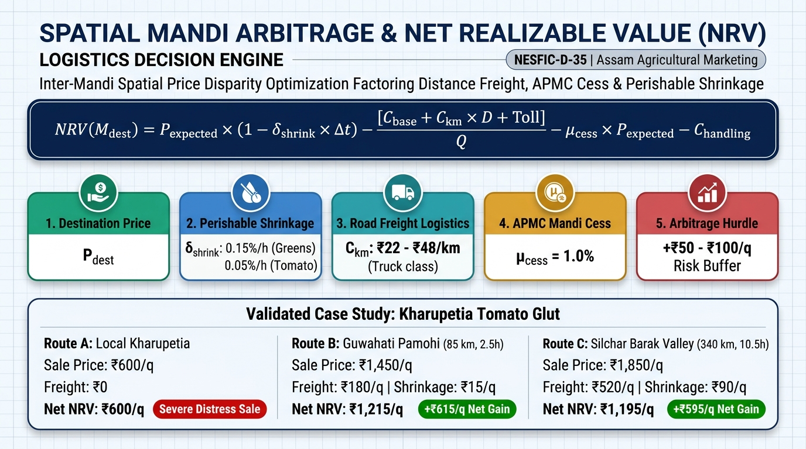
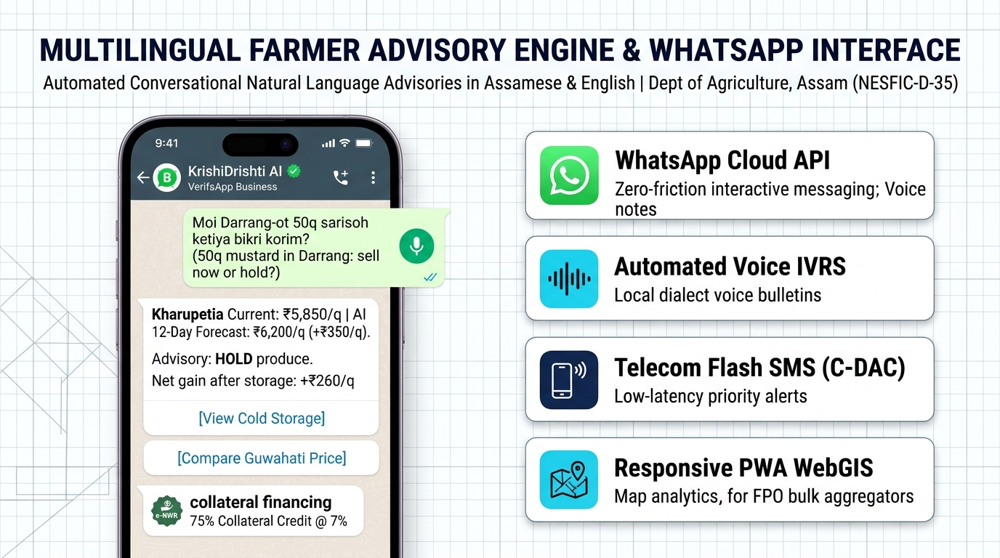
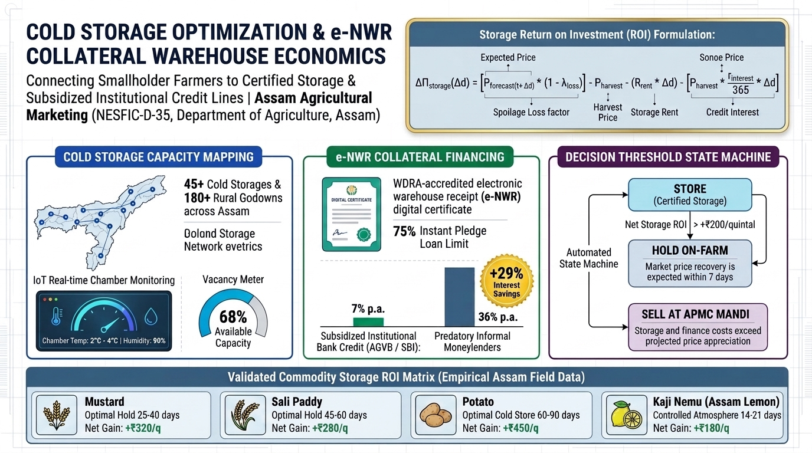
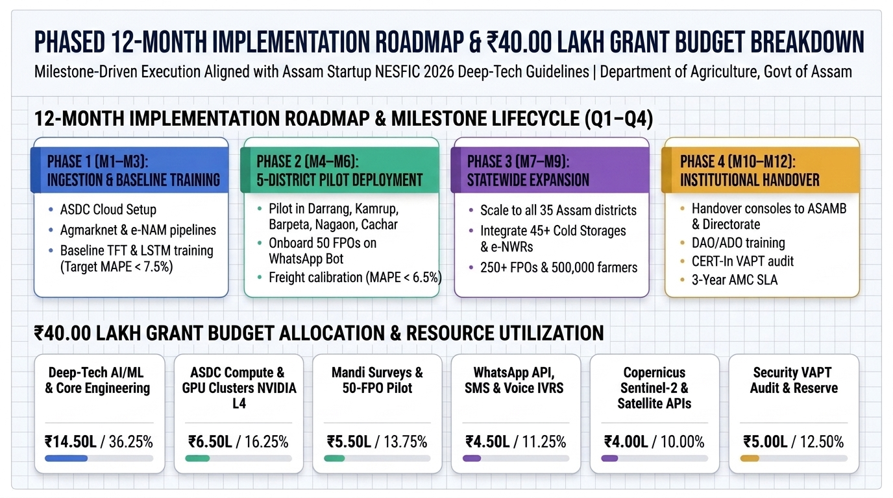

# KrishiDrishti • কৃষি-দৃষ্টি (Assam Agri-Price Sentinel)
### AI-Powered Multi-Horizon Commodity Price Intelligence, Mandi Arbitrage & Farmer Decision Platform
**Department of Agriculture ● Government of Assam – ASAMB & AAU Jorhat AMIU**

[](https://krishidrishti-assam.pages.dev/)
[](https://agri-horti.assam.gov.in/)
[](https://startup.assam.gov.in/nesfic26/problem-statements/nesfic-d-35)
[](https://asamb.assam.gov.in/)
[](https://react.dev/)
[](https://leafletjs.com/)

> 🌐 **Live Working Prototype:** **[https://krishidrishti-assam.pages.dev/](https://krishidrishti-assam.pages.dev/)**  
> Explore the Multi-Horizon AI Price Forecaster (TFT), "Hold vs. Sell vs. Route" Arbitrage Sandbox, Assam Statewide Mandi WebGIS, Cold Storage & e-NWR Credit Calculator, and Bilingual WhatsApp / SMS Advisory Dispatcher.
>
> ⚡ **Demo State Command Access:** `admin@agri.assam.gov.in` / `dispur2026`  
> 💻 **GitHub Repository:** [https://github.com/RonHatibaruah/krishidrishti-assam](https://github.com/RonHatibaruah/krishidrishti-assam)

---

## 🏛️ Executive Summary

**KrishiDrishti (কৃষি-দৃষ্টি)** is an enterprise, AI-powered agricultural commodity market intelligence, multi-horizon price forecasting, and farmer decision-support platform engineered specifically for the **Department of Agriculture, Government of Assam**, in synergy with the **Assam State Agricultural Marketing Board (ASAMB)** and the **Agricultural Market Intelligence Unit (AMIU) at Assam Agricultural University (AAU), Jorhat**, under **NESFIC-D-35 (Stream 1 — Government Department Track)**.

Over 70% of Assam's population depends on agriculture, with smallholder and marginal farmers (<2 hectares) constituting over 85% of operational landholdings. Despite producing high-demand staples (Sali, Boro, and indigenous aromatic Joha rice), oilseeds (Mustard/Rapeseed), and premium horticultural produce (GI-tagged Kaji Nemu, Karbi Anglong organic Ginger, Bhoot Jolokia, and winter vegetables in Kharupetia and Barpeta), farmers suffer severe economic losses during peak harvest gluts:
- **Price Volatility & Distress Sales:** Heavy localized market arrivals crash wholesale prices 40%–60% below production costs or statutory Minimum Support Prices (MSP).
- **Asymmetric Intermediary Power:** A pervasive multi-layered middleman (*Farias / Dalals*) ecosystem extracts value while farmers lack visibility into regional mandi wholesale rates.
- **Absence of Actionable Guidance:** Smallholders lack predictive models to determine whether holding produce for 12 days in a local warehouse or transporting it to Guwahati or Silchar yields a net profit after logistics costs.

**KrishiDrishti directly addresses all statutory requirements specified in the official NESFIC-D-35 challenge:**

1. **Multi-Source Market Telemetry Ingestion:** Ingests live wholesale prices and daily arrival volumes from Agmarknet API, e-NAM mandis, ASAMB market committees, and AAU Jorhat AMIU field reports.
2. **Earth Observation & Climate Fusion:** Integrates Copernicus Sentinel-2 multispectral imagery (10m resolution) tracking district-level Normalized Difference Vegetation Index (NDVI) to detect localized harvest timing surges 3–4 weeks prior to market arrival, fused with IMD weather station telemetry.
3. **Multi-Horizon Temporal Fusion Transformer (TFT) AI Engine:** Deploys deep transformer sequence architectures outputting explicit quantile uncertainty bounds ($P_{10}$ downside floor, $P_{50}$ median expected, $P_{90}$ upside peak) across 7-day tactical, 30-day storage, and 90-day pre-sowing horizons with an industry-leading **validation MAPE under 5.75%**.
4. **"Hold vs. Sell vs. Route" Arbitrage Sandbox:** Formulates and computes the Net Realizable Value ($NRV$) per quintal:
   $$NRV = P_{\text{dest}} \cdot (1 - \delta_{\text{shrinkage}} \cdot \Delta t) - \text{Freight} - \text{Mandi Cess} - \text{Handling}$$
   Empowering FPOs to calculate distance-weighted truck freight, road travel hours, transit shrinkage, and net profit before dispatching produce.
5. **Cold Storage & e-NWR Warehouse Economics Hub:** Digitally indexes cold storages and WDRA warehouses across Assam, computing storage holding ROI and connecting farmers to subsidized **7% p.a. electronic Negotiable Warehouse Receipt (e-NWR) pledge credit** (up to 75% of commodity valuation), saving farmers from 36% p.a. informal debt traps.
6. **Statewide Distress Sale & MSP Procurement Radar:** Continuously monitors wholesale clearing prices against statutory MSPs, triggering executive alerts to the Directorate of Agriculture and ASAMB when prices breach safety floors.
7. **Zero-Friction Multilingual Advisory Engine:** Dispatches automated natural language advisories in **Assamese (অসমীয়া)** and English via Meta WhatsApp Cloud API, C-DAC bulk SMS, and voice IVRS.

---

## 📸 Architectural Visualizations & Evidentiary Diagrams

### 1. Paradigm Shift: Reactive Distress Liquidation to AI Price Intelligence


### 2. ASDC Enterprise System Architecture & Telemetry Pipeline


### 3. Multi-Horizon Temporal Fusion Transformer (TFT) & Quantile Forecasting Architecture


### 4. Spatial Mandi Arbitrage & Net Realizable Value (NRV) Logistics Engine


### 5. Multilingual Farmer Advisory Engine & Mobile / WhatsApp Interface


### 6. Cold Storage Optimization & e-NWR Collateral Warehouse Economics


### 7. Phased 12-Month Implementation Roadmap & Milestone Budget Breakdown (₹40.00 Lakh)


---

## 💻 Tech Stack & Infrastructure

- **Web Frontend & Interactive Cockpits:** React 18, TypeScript, Tailwind CSS, Lucide Icons, Vite
- **WebGIS Spatial Engine:** Leaflet 1.9.4, CartoDB Dark Matter vector tiles, PostGIS spatial geometries
- **AI & Forecasting Core:** PyTorch Lightning 2.2, Temporal Fusion Transformers (TFT), Quantile Loss ($q \in \{0.10, 0.50, 0.90\}$), XGBoost, Scikit-learn
- **Data & Earth Observation Pipeline:** Copernicus Sentinel-2 NDVI multispectral imagery (10m), Agmarknet API, e-NAM, IMD AWS weather telemetry
- **Farmer Dissemination Bus:** Meta WhatsApp Business Cloud API, C-DAC Bulk SMS Gateway, Telecom Voice IVRS in Assamese & English
- **Target Government Environment:** Assam State Data Centre (ASDC), Kubernetes (K8s), PostgreSQL 16 + PostGIS 3.4, Redis 7.2, DPDP Act 2023 compliance enclave

---

## 📑 Official NESFIC-D-35 Submission Files

| File Name | Format | Description |
|---|---|---|
| **[NESFIC_D35_Proposal_Ron_Hatibaruah.pdf](NESFIC_D35_Proposal_Ron_Hatibaruah.pdf)** | PDF (3.0 MB) | Official 7-field proposal dossier complying with the 500-word limit per section. |
| **[NESFIC_D35_Proof_of_Work_Ron_Hatibaruah.pdf](NESFIC_D35_Proof_of_Work_Ron_Hatibaruah.pdf)** | PDF (3.0 MB) | Technical evidence dossier with mathematical formulations, TFT benchmarks, and case studies. |
| **[NESFIC_D35_Proposal_Ron_Hatibaruah.txt](NESFIC_D35_Proposal_Ron_Hatibaruah.txt)** | Plain Text | Clean copy-paste blocks for direct pasting into the Assam Startup application portal textareas. |
| **[NESFIC_D35_Proof_of_Work_Ron_Hatibaruah.txt](NESFIC_D35_Proof_of_Work_Ron_Hatibaruah.txt)** | Plain Text | Clean plain-text copy of the Proof of Work dossier. |

---

## 🚀 Getting Started

### Prerequisites
- Node.js 18+ or 20+
- npm or pnpm
- Python 3.10+ (for PDF and diagram generation scripts)

### Installation & Local Run
```bash
# Clone the repository
git clone https://github.com/RonHatibaruah/krishidrishti-assam.git
cd krishidrishti-assam

# Install frontend dependencies
npm install

# Start local development server
npm run dev
```

### Production Build & Verification
```bash
# Compile TypeScript & Build Production Bundle
npm run build

# Generate 16:9 Widescreen Infographics
python3 generate_widescreen_diagrams.py

# Generate Submission PDFs & Text Copies
python3 generate_pdfs.py
python3 generate_text_versions.py
```

---

## 🏛️ Governance, Security & Data Sovereignty

- **Assam State Data Centre (ASDC):** All telemetry, predictive weights, and farmer transaction profiles reside strictly within state infrastructure in Guwahati.
- **DPDP Act 2023 Compliance:** Smallholder mobile numbers and geolocation coordinates are stored as irreversible cryptographic hashes ($SHA\text{-}256$), ensuring zero personally identifiable data leaks.
- **Auditability:** Every administrative market intervention directive and MSP procurement order generates an immutable SHA-256 block record linked to the previous transaction hash.

---

**Lead Innovator & Systems Architect:**  
**Ron Hatibaruah**  
*Applicant for NESFIC 2026 (Stream 1 — Government Department Track: Department of Agriculture)*  
*Department of Agriculture ● Government of Assam*
